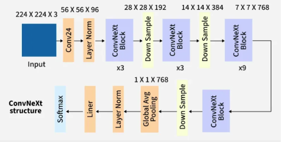
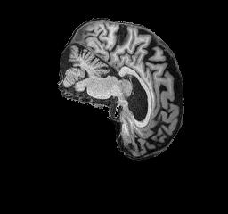
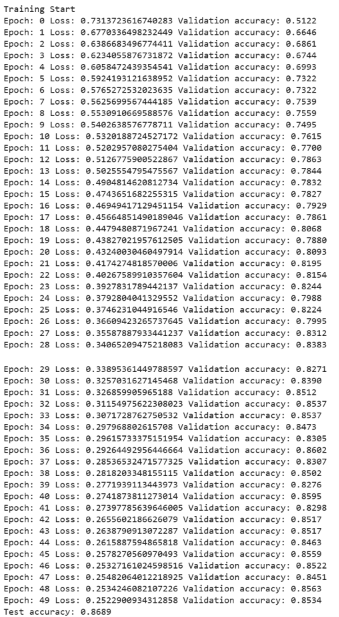
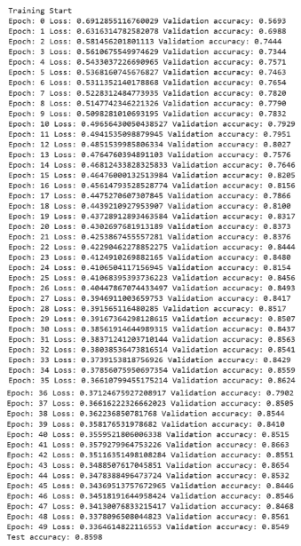
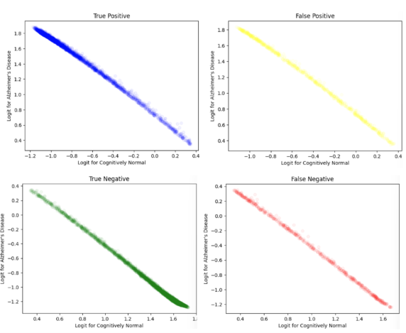
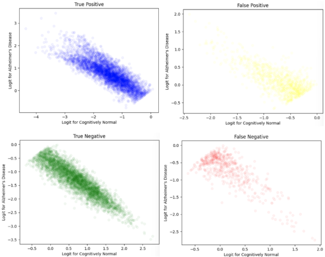

# ConvNeXt ADNI Report - s4803018 (David Pelevin)
## Repo Usage

Both the ConvNeXt and CNN models are contained within modules.py.

The dataset and preprocessing for the ADNI dataset are contained within dataset.py

train.py and predict.py are example scripts that will handle model training and model evaluation respectively. When running said scripts ensure the correct data folders are pointed to on lines 10/11 or 12/13 respectively, the correct saving/loading folder is pointed to on line 99 and 35 respectively, and ensure the correct model is chosen on line 35 and 33 respectively (ConvNeXt or CNN).

## Introduction

This repository focus on the implementation of a ConvNeXt model for identifying Alzheimer's Disease in patients. An ADNI dataset consisting of 2D slices of brain scans with existing train/test splits was provided to train the model. Ideally, the model will quickly and accurately identify the disease, however previous usage of AI models in medical fields revealed drastic overconfidence and overfitting. As a result, the model should be able to identify more uncertain cases that need human review. This facilitates sensible human oversight and accounting for possible errors in the model while still reducing the workload for doctors. ConvNeXt was chosen for its modern image processing design and its use of logits, which can be used to determine the model's confidence.

## Algorithm Breakdown

ConvNeXt models were designed by combining features of convolutional neural networks (CNN) with vision transformers (ViT). Vision Transformers use of self-attention caused them to outperform advanced CNN designs like Res-Net. While Swin Transformers were able to use self-attention with a convolution like sliding window, ViTs naturally scale quadratically to account for the relationships between each frame. As a result, these require immense resources in fields like image processing due to the number of pixels per image. Convolution neural networks have a simpler computational design, and ConvNeXt models combine ViT's self-attention with the simple model of a CNN to achieve higher accuracy. ConvNeXt models have numerous alterations to resemble Swin Transformers, with patchify stem layers, block ratio of (3, 3, 9, 3), GELU activation layers, and layer normalisation over batch all being significant differences between a typical CNN and the ConvNeXt design [1] [2].

A visualisation of the ConvNeXt architecture can be seen below [2]:

## Feasibility Review

### User Need, Scope & Acceptance Criteria

This machine learning model is intended to be used to automatically identify Alzheimer’s disease within a patient’s brain scans. Patients with uncertain results should be flagged for human review, allowing doctors and specialists to focus on more ambiguous cases.

The open research question involves testing advanced models against basic models to determine if the improved accuracy is worth the increased resource requirements. Beyond the required 80% test accuracy required by the task, the following criteria were chosen:

-	10% or less false negative Alzheimer’s identification rate. False negatives lead to untreated diseases, and it is preferable to have false positives over false negatives.
-	Identifiably lower confidence level on at least 80% of incorrect outputs compared to correct ones to allow for effective application of expert reviews. 
-	The model should run quickly to process large datasets, so an inference run-time of around 30ms per 256x240px image on a single A100 or V100 GPU will be required. This is based off prior work for 224x224 pixel images using the same GPUs and model type [1].

### Model Choice & Course Concepts

The chosen model for this task is a ConvNeXt model at the Hard Difficulty band. This model combines the computational simplicity of convolutional neural networks (CNN) with the higher accuracy given by Vision Transformer’s self-attention [1].

ConvNeXt models are based on normal CNNs, providing a good point of comparison. The output logits can be used for confidence levels. The ADNI dataset can also be used as given, since ConvNeXt models were originally designed using 2D images of similar sizes. These factors combine to make this a suitable model for the research question.

### Preliminary Feasibility Evidence

Initial testing of the ADNI dataset confirmed that none of the patients were repeated between the training and testing splits or the Alzheimer’s and Normal categories. Responsible usage of this dataset should prevent the overconfidence of some medical machine learning models.

The dataset consists of 256x240px grayscale images that are not limited to specific shades of grey. These images are larger than those used in the initial ConvNeXt design [1], and since the shades are not limited the images should have sufficient detailing for the model to train on.

Broad resource estimates for a ConvNeXt model based on prior work were given earlier [1].

### Risks, Budget & Fallback

The substantial amount of time and GPU resources necessary can be managed using the Rangpur computing cluster’s V100 and A100 GPUs. Next steps involve testing multiple convolution/layer sizes of the ConvNeXt design on the ADNI dataset. If time or space resources are insufficient, a single ConvNeXt model of appropriate accuracy can be compared to the baseline CNN model instead.

### References

[1] Z. Liu, H. Mao, C.-Y. Wu, C. Feichtenhofer, T. Darrell, and S. Xie, “A ConvNet for the 2020s,”
      in Proc. CVPR, 2022, pp. 11976–11986

## Dependencies and Reproducibility

The following libraries must be installed for this code to run:
-   matplotlib (recommended version 3.10.0)
-   torch (recommended version 2.11.0+cu130)
-   torchvision (recommended version 0.26.0+cu130)
-   pillow (recommended version 11.3.0)
-   scikit-learn (recommended version 1.6.1)

The results of this report should be reproducible due to the usage of specific seeds in train.py and the sorting of Path.glob outputs.

## Example Inputs and Outputs

Expected inputs for the model are 256x240 2D brain scans like this one:

These images are supposed to be opened by an ADNIDataset (found in dataset.py) to be converted to Tensors.

The outputs of the model will be an N x 2 Tensor filled with the logits for each image, where N is the number of images in the batch. These logits represent the confidence of the model for each classification, with the first logit representing Normal Cognition and the second representing Alzheimer's Disease. For simple analysis taking the index of the maximum argument will return the estimated class. Further analysis on approximating uncertain values will be discussed later in the report.

## Preprocessing and Hyperparameter Decisions

Preprocessing occurs with the following steps:

-   Normalisation (ensures bright pixels don't substantially skew training)
-   Random Horizontal Flips (in case any brain scans are reversed)
-   Random crops of the files (to reduce reliance on specific subsets of the brain and improve generalisation)

While Cut-Up and Mix-Up were trialed using the following PyTorch example (https://docs.pytorch.org/vision/main/auto_examples/transforms/plot_cutmix_mixup.html), it appeared to reduce the accuracy by approximately 2% while not substantially increasing the generalisation. While more testing could have been performed with RandAugment and RandomErasing, they were ultimately excluded from this model due to the similarities between the brain scans.

The Hyperparameters were chosen for the following reasons:

-   50 epochs gave enough time for the model to train sufficiently without overfitting drastically.
-   Initial training with learning rates of 1e-3 like in [1] failed to train (got stuck at high loss values) so it was lowered to 4e-4.
-   The ConvNeXt model size of 96 was kept since the brain scan images sizes are similar to that of report [1]. Experiments on lower model sizes of 64 caused lowered accuracy, and increasing the model risked overfitting.
-   Cross Entropy Loss with label smoothing of 0.1 with AdamW optimiser were chosen based on the original ConvNeXt report [1]. Initial tests on Adam optimiser with no label smoothing had slightly worse results.
-   The block ratio of (3, 3, 9, 3) was kept, since smaller models like (2, 2, 6, 2) seemed to perform with lower accuracy and larger models risked overfitting.

## Open Research Dilemna
### Data Hygiene

As alluded to in the Feasibility Review, running an initial data audit on the provided ADNI dataset yields the following:

-   520 unique patients in AD Train
-   556 unique patients in NC Train
-   223 unique patients in AD Test
-   227 unique patients in NC Test
-   0 duplicate patients among the train/test and AD/NC splits

This audit is based on the assumption given by tutors that the filenames follow the format: "patient_id"_"slice_id".jpeg.

After some initial training, it was decided that resplitting the training and test sets would be necessary due to the training set being too repetitive internally. To approximate the original split, 33% of the total patients would be in the Test set. An 80/20 training validation split was used to try and maximise the training samples while ensuring the validation split would not be skewed a individual outliers.

To ensure no data leakage occurs, all splits were performed on the patient level instead of the slice level. This patient level split is performed in dataset.train_val_test_split, the outputs of which are used in the dataset.ADNIDataset. Patient IDs of each slice are checked when constructing the dataset and compared with the given split to ensure no data leakage occurs.

### Quantitative Benchmarking Against CNN

The training printouts (loss and validation accuracy) for the ConvNeXt and CNN models are shown below.

 

As expected, these training results show that the simpler CNN model improved faster than the ConvNeXt model initially. The ConvNeXt finished with a slightly better test accuracy of 86.89% vs the CNN's test accuracy of 85.98%. However, the training loss is higher with the CNN, implying that it has better generalisation.

The Quantitative Results for the best validation epochs are summarised below.

ConvNeXt
-   Accuracy
    -   Training: 96.51%
    -   Validation: 86.02%
    -   Test: 86.37%
-   Number of True Positives/False Positives/True Negatives/False Negatives
    -   Training: 7568, 197, 8183, 372
    -   Validation: 1719, 215, 1808, 281
    -   Test: 4323, 780, 4400, 597
-   Precision for AD/NC
    -   Training: 0.97463, 0.95652
    -   Validation: 0.85480, 0.86549
    -   Test: 0.84715, 0.88053
-   Recall for AD/NC
    -   Training: 0.95315, 0.97649
    -   Validation: 0.85950, 0.86095
    -   Test: 0.87866, 0.84942
-   F1 Score AD/NC
    -   Training: 0.96377, 0.96640
    -   Validation: 0.85714, 0.86321
    -   Test: 0.86262, 0.86469
-   Macro F1 Score and AUROC
    -   Training: 0.96509, 0.96482
    -   Validation: 0.86018, 0.86023
    -   Test: 0.86366, 0.86404

CNN
-   Accuracy
    -   Training: 91.71%
    -   Validation: 86.63%
    -   Test: 85.91%
-   Number of True Positives/False Positives/True Negatives/False Negatives
    -   Training: 7353, 766, 7614, 587
    -   Validation: 1769, 317, 1783, 231
    -   Test: 4406, 909, 4271, 514
-   Precision for AD/NC
    -   Training: 0.90565, 0.92842
    -   Validation: 0.84803, 0.88530
    -   Test: 0.82897, 0.89258
-   Recall for AD/NC
    -   Training: 0.92607, 0.90859
    -   Validation: 0.8845, 0.84905
    -   Test: 0.89553, 0.82452
-   F1 Score AD/NC
    -   Training: 0.91575, 0.91840
    -   Validation: 0.86588, 0.86680
    -   Test: 0.86097, 0.85720
-   Macro F1 Score and AUROC
    -   Training: 0.91707, 0.91733
    -   Validation: 0.86634, 0.86677
    -   Test: 0.85908, 0.86002

The quantitative results above show that the ConvNeXt model has overfitted more than the CNN model has. It has a significantly higher training accuracy, with little improvement regarding the test results. The CNN model is better at detecting Alzheimer's than the ConvNeXt model, as shown by the lower number of false negatives and higher AD Recall in the test set. However, the ConvNeXt boasts a better F1 score and AUROC score, due to its comparable AD F1 score, and better NC performance.

### Resource Profiling Table

The computational efficiency of the models can be seen below. Determined using predict.py.

ConvNeXt
-   Peak GPU VRAM during inference: 0.70 GB
-   Parameter Count: 27818594
-   Inference Run-Time per Image: ~256208 ns

CNN
-   Peak GPU VRAM during inference: 0.61 GB
-   Parameter Count: 773922
-   Inference Run-Time per Image: ~32318 ns

Unsurprisingly the ConvNeXt model is significantly larger and slower than the CNN model. Given the lack of a significant difference between the CNN and ConvNeXt model in performance, this implies that the ConvNeXt model is simply not worth the resources it requires.

### Failure Case Autopsy and Low Confidence Suggestions

Providing suggestions on implementing low confidence requires knowledge on how the logits are distributed for each of the 4 result types (TP, FP, TN, FN). The logit distributions for both the ConvNeXt and CNN are shown below:

 

The CNN model has a clear division in confidence between the false values and their true counterparts. The true values have lower false logits and higher true logits than the false counterparts. The majority of false negative outputs have AD logit above -1, and the false positive outputs have NC logits above -1. By contrast, the true positive has most values between -1 and -3 on the NC logit and the true negative has most values between -1 and -2.5. As a result, requiring the outputs to have a lower logit beneath -1 seems sufficient for dividing high confidence and low confidence results.

The ConvNeXt model has the false negative and false positive values follow the true negative and true positive values more closely. While the true values tend to group at the extremes of the logit range, the false values have a fairly even distribution along the line making it difficult to distinguish them. A reasonable cut-off point for high confidence seems to be true logits above 1.0. Both the true positive and true negative values image density increases past AD logit = 1.0 and NC logit = 1.0 respectively. While this will cause some of the false values to be considered high confidence, the even distribution will cause a greater percentage to exist in the uncertain range than the high confidence. Thus, requiring the outputs to have an upper logit above 1 seems reasonable for dividing high confidence and low confidence results.

### Conclusion

Ultimately, I cannot recommend the use of this ConvNeXt model over the baseline CNN model. Despite the more complex architecture and self-attention techniques, the ConvNeXt model performed similarly to the simpler CNN model in terms of accuracy and other metrics. In addition, the CNN model had clearer generalisation and better confidence divisions. The CNN model should be implemented with uncertainty when the smaller logit is above -1. If the ConvNeXt model is implemented, it's uncertain values should occur when the larger logit is below 1. Either way, the models were able to successfully train to be approximately 86% accurate, with the ability to detect some low confidence inputs. A normal CNN model with sufficient pre-processing is able to reasonably detect Alzheimer's Disease in patients.

## Artificial Intelligence Usage Disclosure

Claude Sonnet 5.5 Medium was used to help provide information and advice during the coding process.

Specifically:
-   Identifying how to calculate channel sizes during ConvNeXt stages
-   Debugging a Data Leakage Error that occurred in the Validation set
-   Advice for reducing overfitting (which was mostly ignored due to clashes with the task description)
-   Helped write code in previous demos that was adapted here
-   Assisted with parameter counts and VRAM usage detection

AI-suggested code was always checked against PyTorch documentation and ConvNeXt reports/explanations for validity and understanding. AI code was always rewritten with said understanding. The algorithms were also tested before and after changes to verify the desired functionality of said AI code. Code from previous demos were verified at the time, with appropriate adaptions made based on knowledge gained from the time.

## References

[1] Z. Liu, H. Mao, C.-Y. Wu, C. Feichtenhofer, T. Darrell, and S. Xie, “A ConvNet for the 2020s,”
      in Proc. CVPR, 2022, pp. 11976–11986

[2] GeeksforGeeks, “ConvNeXt,” GeeksforGeeks. Accessed: Oct. 30, 2026. [Online].
      Available: https://www.geeksforgeeks.org/computer-vision/convnext/